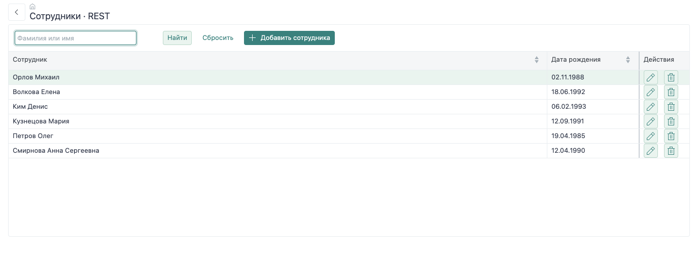

# Приложение Demo-company

В этом руководстве ты соберёшь приложение для работы с сотрудниками и их контактами: запустишь сервер и базу, разберёшь модель данных, откроешь реестр, настроишь карточку и сохранение связанных записей. В конце создашь ещё одну пару форм через генератор.

В приложении два экрана с одной моделью данных. **REST** вызывает обработчики прикладного модуля. **serverEndpoints** описывает запросы и операции в классе формы. Можно открыть сотрудника в одном экране, изменить его в другом и увидеть тот же результат.



## Порядок работы

| Шаг | Что получится |
| --- | --- |
| [Подготовка и запуск](/nfjs/guide/setup) | Работающее приложение, вход пользователя и шесть сотрудников |
| [Модуль и модель данных](/nfjs/guide/model) | Связь таблиц, представлений чтения и операций broker |
| [Реестр и поиск](/nfjs/guide/list) | Таблица с поиском, сортировкой и открытием карточки |
| [Карточка и сохранение](/nfjs/guide/card) | Загрузка записи, биндинги, валидация и запись изменений |
| [Сотрудник и контакты](/nfjs/guide/relations) | Сохранение родителя и журнала изменений дочерней коллекции в одной транзакции |
| [Генерация своих форм](/nfjs/guide/generation) | Карточка и реестр по метаданным, собственный шаблон формы |

## Исходники приложения

[Скачать учебное приложение](../../examples/nfjs-guide.zip ':ignore') и распаковать в отдельный каталог. В архиве находятся конфигурация, Docker Compose, прикладной модуль, формы и исходники базы. Пароли задаются при запуске в `.env`.

Готовый модуль позволяет сначала запустить весь сценарий, затем последовательно разобрать и изменить каждую часть. Команды следующих страниц выполняются из корня распакованного приложения.

```text
nfjs-guide/
  index.js
  config.example.json
  compose.yaml
  modules/demo-company-guide/
    nf-module.js
    lib/employees.js
    forms/guide/rest/
    forms/guide/endpoints/
    templates/
    dbsrc/company/
```

Имена `guide.rest.list` и `guide.endpoints.list` — идентификаторы форм. Пути `/guide/employee/list` и `/guide/employee/save` — HTTP-маршруты. Они принадлежат разным механизмам и не обязаны совпадать.

Общие параметры `dbapi`, устройство сессии и правила транзакций описаны в [справочнике backend](/nfjs/backend/modules). Здесь они применяются к конкретным шагам приложения.
