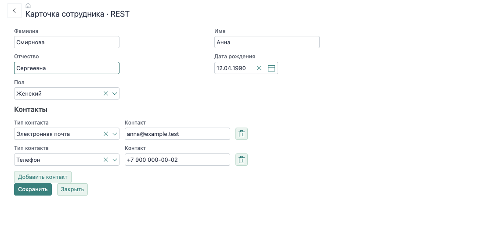

# Карточка и сохранение

Карточка получает `employeeId` при открытии, загружает сотрудника и связывает его поля с контролами. Новая запись начинается с пустого объекта и получает `id` после успешного сохранения.



## 1. Объяви состояние

```js
static properties = {
  urlParams: { value: () => ['employeeId'] },
  employeeId: {},
  employee: { type: Object, value: () => ({ gender: 2 }) },
  contacts: { type: Array, value: () => [] },
  invalid: { type: Boolean, value: false },
  saving: { type: Boolean, value: false },
  employeeChanged: { type: Boolean },
  contactsChanged: { type: Boolean }
};
```

Фабрики `value` создают отдельные объект и массив для каждого экземпляра формы. `employeeId` — параметр навигации; `employee.id` — идентификатор загруженной записи. После создания они должны соответствовать одной записи.

## 2. Загрузи запись

| REST | serverEndpoints |
| --- | --- |
| `aGet` вызывает `/guide/employee/get` | `aGet` выполняет `action.aGet` в классе формы |
| Обработчик читает `context.body.args.employeeId` | Параметр `:employeeId` получает значение из аргументов действия |
| Отправляет `{ data: employee }` | Запрос `@main` возвращает первую запись |

Клиентский вызов одинаков:

```js
const employee = await this.$.aGet.execute({ employeeId: this.employeeId });
this.employee = employee;
this.$.obEmployee.snapshot();
```

Снимок принимается **после** загрузки: эти значения считаются сохранённым состоянием. В полной карточке сотрудник и контакты загружаются параллельно, затем оба наблюдателя получают новые снимки.

## 3. Свяжи поля и валидацию

```html
<pl-valid-observer invalid="{{invalid}}"></pl-valid-observer>
<pl-input label="Фамилия" value="{{employee.lastname}}" required></pl-input>
<pl-input label="Имя" value="{{employee.firstname}}" required></pl-input>
<pl-datetime label="Дата рождения" value="{{employee.birthdate}}" required></pl-datetime>
<pl-data-observer id="obEmployee" data="{{employee}}"
  is-changed="{{employeeChanged}}"></pl-data-observer>
```

Двусторонние биндинги обновляют свойства `employee`. `pl-valid-observer` собирает состояние обязательных полей; `pl-data-observer` сравнивает данные со снимком. Это разные задачи: корректные данные могут быть изменёнными, а неизменённые — не пройти текущую проверку формы.

Булевы свойства, передаваемые в вычисляемую функцию биндинга, имеют начальное значение `false`: при `undefined` Polylib может отложить её вычисление.

Кнопка сохранения отключается, когда `invalid` или `saving` истинны. `saving` связан с `executing` действия, поэтому повторный щелчок во время запроса не запускает ещё одно сохранение.

## 4. Сохрани и перечитай результат

### REST

```js
const result = await this.$.aSave.execute({
  employee: this.employee,
  contacts: this.contacts._mutations
});
this.employeeId = result.id;
await this.reload();
```

#### Маршрут и аргументы

`aSave` обращается к `/guide/employee/save`. Маршрут регистрируется в `nf-module.js` и передаёт запрос функции из `lib/employees.js`:

```js
import { web } from '@nfjs/back';
import { save } from './lib/employees.js';

async function init() {
  web.on('POST', '/guide/employee/save',
    { middleware: ['session', 'auth', 'json'] }, save);
}
```

`session` подготавливает сессию, `auth` проверяет вход, `json` разбирает тело. В обработчике аргументы находятся в `context.body.args`: `pl-action` добавляет оболочку `args` самостоятельно.

```json
{
  "args": {
    "employee": { "id": 1, "lastname": "Смирнова", "firstname": "Анна" },
    "contacts": {
      "add": [{ "contact_type": 2, "contact": "anna@example.test" }],
      "upd": [],
      "del": [],
      "touch": []
    }
  }
}
```

Здесь поля сотрудника сокращены для чтения. При создании форма также отправляет обязательные `gender` и `birthdate`. При обновлении `id` определяет существующую запись. Контакты передаются журналом: неизменённые строки в него не входят.

#### Одна запись: отдельные create и update

Для карточки без связанных изменений достаточно одного `dbapi.broker`. Такой подход использует [карточка из генератора](/nfjs/guide/generation): frontend выбирает маршрут создания или изменения по наличию `employee.id`.

| Маршрут | Аргументы | Операция |
| --- | --- | --- |
| `/guide/employee/create` | Поля сотрудника без `id` | `company.employee.add` |
| `/guide/employee/update` | `id` и изменяемые поля | `company.employee.upd` |

```js
import { dbapi } from '@nfjs/back';
import { api } from '@nfjs/core';

export async function create(context) {
  try {
    const result = await dbapi.broker(
      'company.employee.add', context.body.args, { context }
    );
    context.send({ data: result.data });
  } catch (error) {
    context.send(api.nfError(error).json());
  }
}
```

В `update` вызывается `company.employee.upd` с тем же форматом аргументов; для него нужен ключ `id`. `dbapi.broker` сам получает соединение, начинает транзакцию, выполняет операцию, делает commit или rollback и освобождает соединение. Дополнительный `getConnect()` вокруг одиночного вызова не требуется.

После создания ответ имеет вид `{ data: { id: 7 } }`. `execute()` возвращает `{ id: 7 }`, поэтому форма сохраняет ключ и при следующем сохранении вызывает обновление.

#### Сотрудник и контакты: одно соединение

У основной карточки `/guide/employee/save` — составная операция: сотрудник и все изменения контактов сохраняются вместе. Здесь соединением и транзакцией управляет обработчик.

<details class="docs-code">
<summary>Полный REST-обработчик сохранения</summary>

```js
import { dbapi } from '@nfjs/back';
import { api } from '@nfjs/core';

export async function save(context) {
  const { employee, contacts = {} } = context.body.args;
  const connect = await dbapi.getConnect(context);
  try {
    await connect.begin();
    const result = await connect.broker(
      employee.id ? 'company.employee.upd' : 'company.employee.add', employee
    );
    const id = employee.id ?? result.data.id;

    for (const row of contacts.del ?? []) {
      await connect.broker('company.employee_contact.del', { id: row.id });
    }
    for (const row of contacts.upd ?? []) {
      await connect.broker('company.employee_contact.upd', row);
    }
    for (const row of contacts.add ?? []) {
      await connect.broker('company.employee_contact.add', { ...row, employee_id: id });
    }

    await connect.commit();
    context.send({ data: { id } });
  } catch (error) {
    await connect.rollback();
    context.send(api.nfError(error).json());
  } finally {
    await connect.release();
  }
}
```

</details>

**Сначала сохраняется сотрудник.** Для новой записи broker возвращает ключ, существующая использует переданный `employee.id`. На этом этапе commit ещё не выполнен: изменение сотрудника можно откатить вместе с последующей ошибкой контакта.

**Затем обрабатывается журнал контактов.** Удалению передаётся только `id`; обновлению — строка с ключом и полями. Для добавления сервер назначает `employee_id` после копирования полей строки, поэтому ключ родителя берётся из сохранённого сотрудника. В примере удаления выполняются перед добавлениями — это позволяет заменить запись, на которую распространяется уникальное ограничение.

**Все вызовы идут через один `connect`.** Если внутри этой последовательности вызвать `dbapi.broker`, он откроет отдельное соединение и не будет частью общей транзакции. Повторно передавать `{ context }` в `connect.broker` не нужно: сессия уже связана с соединением.

**Commit выполняется после всех дочерних записей.** Только затем отправляется успешный ответ с `id`. При ошибке любого вызова rollback отменяет и сотрудника, и уже обработанные контакты. `finally` освобождает соединение при обоих исходах.

В этом контракте сотрудник сохраняется при каждом нажатии, а контакты — только по журналу. Если нужно сохранять одну область независимо, выдели для неё отдельную операцию и принимай снимок только этой области; см. [сохранение части формы](/nfjs/partial-save). Вложенные коллекции контактов потребовали бы отдельного обхода их журналов — одного `contacts.upd` для них недостаточно.

#### Ошибка и состояние формы

Права записи, обязательность полей и ограничения проверяются внутри broker и базы. HTTP-обработчик передаёт ошибку через `api.nfError(error).json()`. Пользовательский текст ограничения можно задать в [`msgs.json`](/nfjs/backend/errors).

`pl-action` показывает сообщение и отклоняет Promise. Поэтому код после `await this.$.aSave.execute(...)` не выполняется: карточка не вызывает `reload()` и не принимает новый снимок. Введённые значения остаются доступными для исправления. После успешного ответа карточка перечитывает сотрудника и контакты, получает серверные ключи и принимает снимки уже сохранённого состояния.

### serverEndpoints

```html
<pl-action id="aSave" paths="contacts" executing="{{saving}}"></pl-action>
```

```js
const result = await this.$.aSave.execute({
  ...this.employee,
  contacts: this.contacts
});
this.employeeId = result.id;
await this.reload();
```

В REST аргументы разделены на объект сотрудника и журнал контактов. В операции формы поля сотрудника лежат в корне, а `paths="contacts"` преобразует дочернюю коллекцию для вложенных действий. Формат выбирается по серверному контракту; это не взаимозаменяемые тела запроса.

`reload()` возвращает состояние из базы и принимает снимки. Если запрос завершился ошибкой, выполнение не доходит до перечитывания: введённые значения и признаки изменений остаются в форме.

## 5. Обработай закрытие

```js
onClose() {
  if (this.employeeChanged || this.contactsChanged) {
    return this.showConfirm('Закрыть карточку без сохранения изменений?');
  }
}
```

Проверяются обе области данных. После сохранения и принятия снимков подтверждение не нужно. При ошибке записи оно продолжает защищать несохранённый ввод.

## Проверь результат

1. Открой существующего сотрудника и измени отчество.
2. Удали обязательную фамилию: сохранение должно стать недоступным. Верни фамилию.
3. Сохрани карточку, закрой и открой заново: отчество должно сохраниться.
4. Измени поле и закрой карточку без сохранения: должно появиться подтверждение.
5. Через «Добавить сотрудника» заполни новую запись. После сохранения у неё появится `id`, а повторное сохранение должно изменить эту запись.

<details class="docs-code">
<summary>Полная карточка: REST</summary>

[REST](../../examples/nfjs/modules/demo-company-guide/forms/guide/rest/card.js ':include :type=code javascript')

</details>

<details class="docs-code">
<summary>Полная карточка: serverEndpoints</summary>

[serverEndpoints](../../examples/nfjs/modules/demo-company-guide/forms/guide/endpoints/card.js ':include :type=code javascript')

</details>

Дальше: [сотрудник и контакты](/nfjs/guide/relations).
