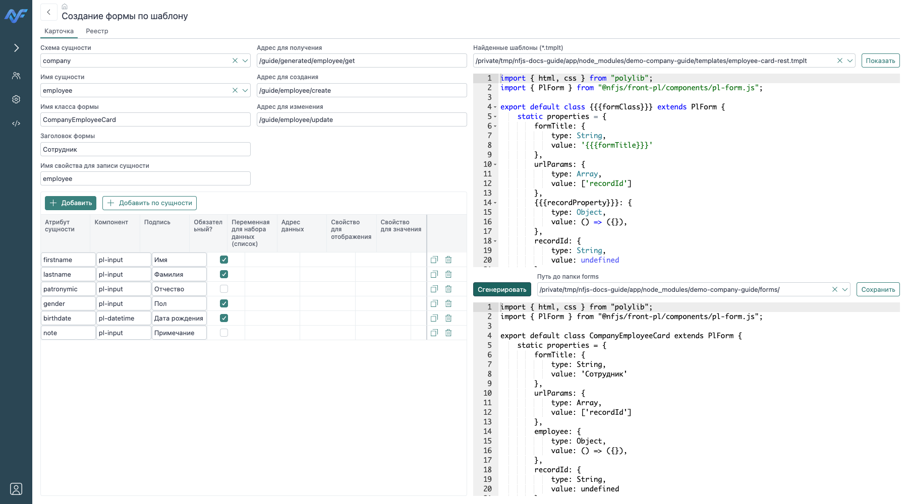

# Генерация своих форм

Генератор `@nfjs/dev` берёт метаданные таблицы и создаёт JavaScript формы по `.tmplt`. В этом шаге создадим карточку сотрудника и реестр на `pl-table`, затем заменим шаблон карточки собственным.

## 1. Открой генератор

Перейди в **«Инструменты разработчика → Генерация форм»** (`dev.generate-form`). Откроется форма «Создание формы по шаблону». На вкладке «Карточка» выбери схему `company`, сущность `employee` и нажми «Добавить по сущности».

Если открываешь генератор из раздела с уже переданными `entitySchema` и `entityName`, список полей может быть заполнен. Повторная команда добавляет поля к имеющимся — сначала проверь список, чтобы не получить дубли.



## 2. Настрой карточку

| Настройка | Значение |
| --- | --- |
| Класс формы | `CompanyEmployeeCard` |
| Заголовок | `Сотрудник` |
| Свойство записи | `employee` |
| Адрес для получения | `/guide/generated/employee/get` |
| Адрес для создания | `/guide/employee/create` |
| Адрес для изменения | `/guide/employee/update` |

Удали поле `id` из редактора: ключ создаёт база. Оставь имя, фамилию, отчество, пол, дату рождения и примечание. Для даты генератор выбирает `pl-datetime`; остальные компоненты можно изменить в настройках. Для `gender` в исходной модели используются числовые значения `1` и `2`; в полноценной карточке руководства им соответствуют варианты комбобокса.

Стандартная карточка открывается с параметром **`recordId`**. Поэтому её маршрут чтения `/guide/generated/employee/get` ожидает `args.recordId`. Карточка предыдущих шагов использует `employeeId`; эти два контракта имеют отдельные маршруты.

Выбери `form-card.tmplt`, нажми «Показать», затем «Сгенерировать». В результате проверь биндинги `employee.*`, наличие маршрутов и отсутствие редактируемого поля `id`.

## 3. Сохрани и открой результат

Выбери папку `forms` модуля `demo-company-guide` и нажми «Сохранить». Путь строится из схемы, сущности и типа формы:

```text
forms/company/employee/card.js
```

Идентификатор формы — `company.employee.card`. Открой её по адресу `http://127.0.0.1:4185/#company.employee.card?recordId=1`, используя `id` существующего сотрудника. При необходимости обнови страницу после перезаписи файла формы, чтобы браузер загрузил новый класс.

Измени примечание, сохрани и перечитай запись. Проверь также создание без `recordId`: после первого сохранения карточка должна получить ключ созданной записи.

## 4. Создай реестр

Переключись на вкладку «Реестр» и укажи:

| Настройка | Значение |
| --- | --- |
| Класс формы | `CompanyEmployeeList` |
| Заголовок | `Сотрудники` |
| Адрес списка | `/guide/employee/list` |
| Адрес удаления | `/guide/employee/delete` |
| Форма карточки | `company.employee.card` |
| Шаблон | `form-list.tmplt` |

Добавь колонки по сущности, оставь фамилию, имя и дату рождения. Для даты укажи `kind: date`. При необходимости включи сортировку и изменение ширины. Для поиска добавь фильтр поля `lastname`, компонент `pl-input`, оператор `like_both`.

Сгенерируй и сохрани `forms/company/employee/list.js`. Открой `#company.employee.list`: должны отображаться все сотрудники, фильтр должен искать фамилию, кнопка строки — открывать карточку с `recordId`.

## 5. Подключи свой шаблон

В модуле находятся два шаблона карточки с одинаковой двухколоночной раскладкой:

| Шаблон | Связь с сервером |
| --- | --- |
| `templates/employee-card-rest.tmplt` | Адреса `endpointRead`, `endpointCreate`, `endpointUpdate` из настроек генератора |
| `templates/employee-card-endpoints.tmplt` | Блок `serverEndpoints` с чтением `v4employee` и broker-операциями сотрудника |

Выбери один из них в «Найденные шаблоны», нажми «Показать» и снова сгенерируй карточку. Параметры полей остаются прежними; меняются раскладка и способ подключения операций.

В REST-варианте проверь адреса действий. В варианте `serverEndpoints` у `aRead`, `aCreate` и `aUpdate` нет `endpoint`: их `id` совпадают с ключами серверного блока. Запрос чтения использует `recordId`, операции записи — `company.employee.add` и `company.employee.upd`.

Сохранение записывает файл по тому же пути. Перед заменой сохрани свои ручные изменения или выбери отдельный каталог для эксперимента. Генератор не объединяет новый результат с ранее отредактированным JavaScript.

## Что проверить после генерации

* Поля связаны с выбранным свойством `employee`, включая результат чтения и аргументы сохранения.
* Для колонок даты и числа настроены нужные `kind` и `format`.
* Маршруты существуют, а ответы соответствуют ожидаемому `{ data: ... }`.
* Ссылочные поля получают реальные данные и настроенные `text-property`/`value-property`.
* Создание возвращает `id`; повторное сохранение изменяет ту же запись.
* В реестре видны строки, работает поиск и открытие карточки.

Справочник всех настроек — в [генераторе форм](/nfjs/tools/generators). Устройство `.tmplt`, вставки Handlebars и биндинги Polylib — в [собственных шаблонах](/nfjs/tools/templates).
