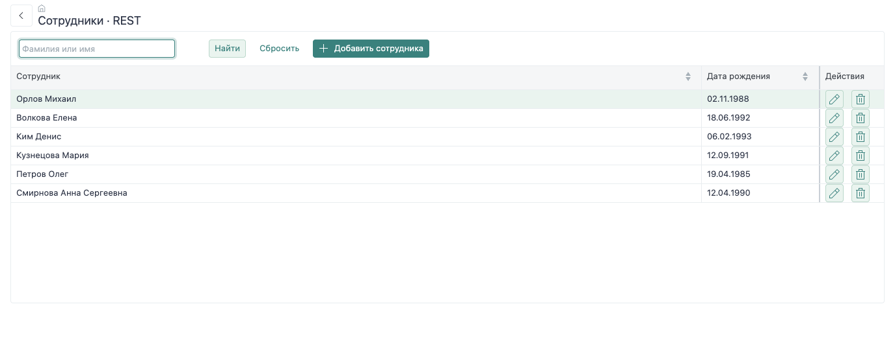

# Реестр и поиск

Реестр получает коллекцию сотрудников через `pl-dataset`, передаёт её в `pl-table` и открывает карточку выбранной строки. Поиск и сортировка изменяют условия запроса; сервер возвращает новый набор данных.



## 1. Свяжи данные и таблицу

```html
<pl-table data="{{rows}}" selected="{{selected}}"
  on-row-dblclick="[[editRow]]">
  <pl-table-column header="Сотрудник" field="fio" sortable></pl-table-column>
  <pl-table-column header="Дата рождения" field="birthdate"
    kind="date" sortable></pl-table-column>
</pl-table>
```

`rows` — коллекция строк, `selected` — выбранная запись. `fio` вычисляется в запросе из имени, фамилии и отчества. Дата хранится как дата; `kind="date"` отвечает за её отображение в таблице.

Для таблицы задана высота `420px`, поэтому при увеличении числа записей прокручиваются строки. Панель поиска помещена в слот `top-toolbar` внутри `pl-flex-layout`; её элементы сохраняют собственную ширину.

## 2. Выбери способ загрузки

### REST

В форме указан HTTP-маршрут:

```html
<pl-dataset id="dsList" data="{{rows}}"
  endpoint="/guide/employee/list"></pl-dataset>
```

Обработчик передаёт параметры управления запросом в четвёртом аргументе `dbapi.query`:

```js
export async function list(context) {
  const result = await dbapi.query(`
    select id, concat_ws(' ', lastname, firstname, patronymic) as fio,
           firstname, lastname, patronymic, gender, birthdate
      from company.v4employee`, {}, { context }, context.body.control);
  context.send(result);
}
```

`context.body.control` содержит фильтры, сортировки и, если используется постраничная загрузка, диапазон. Если не передать его в запрос, изменение заголовка таблицы не изменит порядок строк на сервере.

### serverEndpoints

В разметке остаётся тот же `id`, а `endpoint` опускается:

```html
<pl-dataset id="dsList" data="{{rows}}"></pl-dataset>
```

```js
serverEndpoints = {
  dataset: {
    dsList: {
      text: `select id, concat_ws(' ', lastname, firstname, patronymic) as fio,
                    firstname, lastname, patronymic, gender, birthdate
               from company.v4employee`
    }
  }
}//serverEndpoints
```

Обработчик набора данных сам применяет `control`. Для `dataset` используется ключ `text`; у действия `action` структура другая. Блок принадлежит классу формы, а SQL исполняется на сервере.

## 3. Передай условие поиска

```js
search() {
  this.set('rows.filters', this.query
    ? [{ field: 'fio', operator: 'like_both', value: this.query }]
    : []);
  return this.$.dsList.execute();
}
```

Поле `fio` должно быть доступно в результате исходного запроса: провайдер применяет управление выборкой к его колонкам. `like_both` ищет вхождение строки. Очистка поиска передаёт пустой массив фильтров, поэтому прежнее условие перестаёт действовать.

Начальная загрузка выполняется в `onConnect()`. Сортировка заголовка меняет `rows.sorts`; связанный набор данных обрабатывает изменение и запрашивает строки заново. Подробности операторов и диапазона — в [управлении запросом](/nfjs/backend/query-control).

## 4. Открой карточку

```js
async editRow(event) {
  await this.open('guide.rest.card', { employeeId: event.model.row.id });
  await this.$.dsList.execute();
}
```

Идентификатор берётся из `event.model.row`. Это контекст строки таблицы, доступный и обработчику двойного щелчка, и кнопке внутри шаблона ячейки. После закрытия карточки реестр загружается заново, поэтому в нём видны сохранённые изменения.

В варианте `serverEndpoints` открывается `guide.endpoints.card`; остальной порядок тот же.

## Проверь результат

1. Введи «Анна» и нажми «Найти»: должна остаться Анна Смирнова.
2. Сбрось поиск: вернутся все шесть строк.
3. Нажми заголовок «Сотрудник»: порядок должен измениться. В запросе появится `control.sorts`.
4. Открой карточку кнопкой строки, закрой её и убедись, что реестр обновился.

<details class="docs-code">
<summary>Форма реестра: REST</summary>

[REST](../../examples/nfjs/modules/demo-company-guide/forms/guide/rest/list.js ':include :type=code javascript')

</details>

<details class="docs-code">
<summary>Форма реестра: serverEndpoints</summary>

[serverEndpoints](../../examples/nfjs/modules/demo-company-guide/forms/guide/endpoints/list.js ':include :type=code javascript')

</details>

Дальше: [карточка и сохранение](/nfjs/guide/card).
