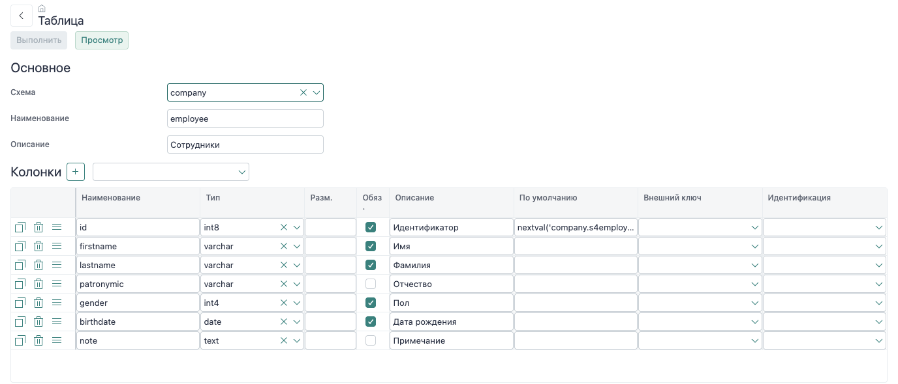

# Модуль и модель данных

Модуль `demo-company-guide` объединяет исходники базы, серверные операции, формы и меню. Его область ответственности — сотрудники и контакты. Прикладные файлы находятся вместе, поэтому модель и использующие её экраны изменяются согласованно.

## Данные сотрудника

| Объект | Содержимое |
| --- | --- |
| `company.employee` | Имя, фамилия, отчество, пол, дата рождения и примечание |
| `company.employee_contact` | Тип контакта, значение и ссылка `employee_id` на сотрудника |
| `company.v4employee` | Представление чтения сотрудников с проверкой доступа к разделу |
| `company.v4employee_contact` | Представление чтения контактов |

Один сотрудник имеет несколько контактов. Внешний ключ связывает контакт с сотрудником, а обязательные поля и типы проверяет PostgreSQL. Прикладной код не должен подменять эту связь поиском сотрудника по ФИО.

В базе используются технические идентификаторы `id`. При создании сотрудника идентификатор возвращает broker; только после этого новые контакты получают его в `employee_id`.

## Чтение и запись

Запрос реестра читает `company.v4employee`, а не таблицу напрямую. Представление содержит проверку `nfc.f4role_unitprivs8check('company.employee')`. Без права просмотра оно не возвращает строки.

```sql
select id, concat_ws(' ', lastname, firstname, patronymic) as fio,
       birthdate
  from company.v4employee
```

Сохранение вызывает зарегистрированные операции:

| Действие | Сотрудник | Контакт |
| --- | --- | --- |
| Создать | `company.employee.add` | `company.employee_contact.add` |
| Изменить | `company.employee.upd` | `company.employee_contact.upd` |
| Удалить | `company.employee.del` | `company.employee_contact.del` |

Разделы и операции описаны в данных `nfc.modulelist` внутри `dbsrc/company/dat`. Миграция переносит эти настройки вместе со структурой базы. Для стандартных операций записи broker проверяет права и выполняет изменение; frontend не отправляет SQL записи.

В Demo-company также есть модели карточек сотрудника и периодов недоступности. Они используются в [примерах вложенных изменений](/nfjs/nested-changes); для первых шагов достаточно сотрудника и контактов.

## Подключение модуля

`nf-module.js` экспортирует `meta`, `menu`, `msgs` и `init`. Метаданные задают порядок загрузки, `init` регистрирует HTTP-маршруты. Полный файл небольшой, но его полезно разбирать по назначению каждого экспорта.

<details class="docs-code">
<summary>nf-module.js</summary>

[nf-module.js](../../examples/nfjs/modules/demo-company-guide/nf-module.js ':include :type=code javascript')

</details>

В этом составе приложения модуль загружается после `@nfjs/front-pl` и перед `@nfjs/back-dbfw`: сначала создаются маршруты меню форм, затем DBFW переопределяет их с учётом прав. Это требование подключения используемых модулей. Порядок элементов `modules.only` сам по себе не задаёт порядок инициализации.

## Изменение модели через редактор

Открой **«Объекты базы данных»**, выбери схему `company`, тип «Таблицы» и объект `employee`.



Например, `note` — необязательная колонка типа `text` с описанием «Примечание». В готовом модуле она уже есть. Для упражнения измени её описание, нажми «Просмотр», проверь SQL и выполни изменение. Это меняет объект в базе; файл модуля обновляется отдельным шагом.

Открой **«Подготовка исходников БД»**, выбери таблицу `company.employee` и сохрани её. Изменение должно появиться в `dbsrc/company/src/table/employee.sql`. Если меняется состав чтения, обнови и сохрани также `company.v4employee`.

Детальный порядок работы с колонками, ограничениями, SQL и экспортом — в [редакторе БД](/nfjs/tools/db-editor). Имена объектов и устройство исходников — в [соглашениях по базе](/nfjs/backend/database-style) и [миграциях](/nfjs/backend/dbsrc).

Дальше: [реестр и поиск](/nfjs/guide/list).
