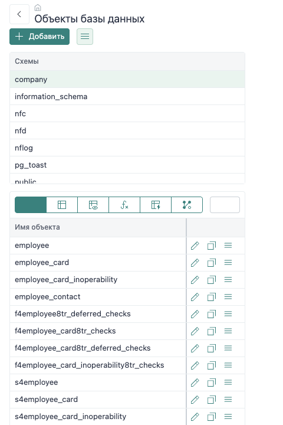
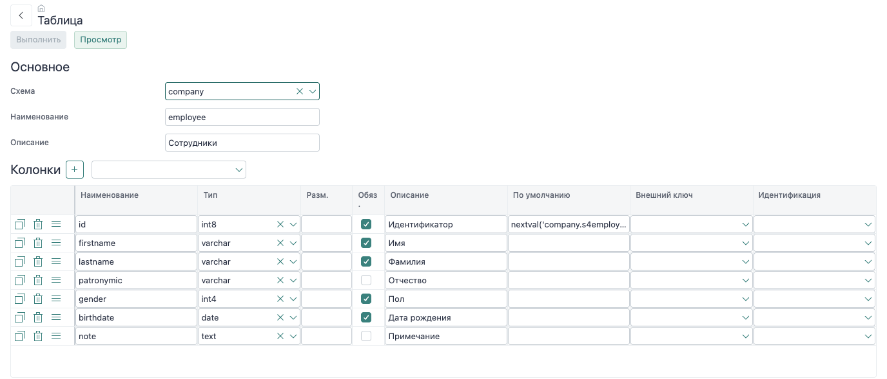

# Редактор объектов PostgreSQL

Открой в меню **«Объекты базы данных»** из `@nfjs/db-editor`, чтобы просматривать объекты выбранной схемы, менять описание объекта в форме и выполнять SQL-скрипт изменений в подключённой базе. Редактор работает с таблицами, представлениями, функциями, последовательностями и триггерами. Он изменяет базу данных напрямую; запись изменений в `dbsrc` выполняется отдельно через инструмент подготовки исходников `@nfjs/dev`.

## Выбор и изменение объекта

На стартовом экране выбери схему и тип объекта: таблица, представление, функция, последовательность или триггер. Двойной щелчок по строке или кнопка редактирования открывает форму объекта. Кнопка копирования создаёт новый объект на основе описания выбранного; удаление отдельным действием сразу выполняет `DROP` после подтверждения.

Для существующих объектов редактор сначала читает описание из базы. Изменения формы сопоставляются с этим исходным описанием. У нового объекта исходного описания нет, поэтому редактор строит SQL создания. Выбирай схему, имя и связанные параметры в форме объекта, затем проверь скрипт кнопкой «Просмотр».

## Таблица: колонки, ограничения и индексы

В основной части таблицы задаются схема, имя и комментарий. Для каждой колонки редактор хранит имя, тип, длину типа, флаг обязательности, комментарий, значение по умолчанию, ссылочную таблицу и режим identity.

| Поле | Что задаёт |
| --- | --- |
| Имя | SQL-идентификатор колонки. Имя проверяется по шаблону и по списку зарезервированных слов редактора. |
| Тип и размер | Тип PostgreSQL из списка; поле типа допускает ввод своего значения. Размер используется типами, для которых он применим. |
| Обязательная | При включении формируется требование `NOT NULL`. |
| Значение по умолчанию | SQL-выражение, например `now()` или `current_date`; редактор не трактует его как обычный текстовый литерал. |
| Внешний ключ | Таблица назначения. При выборе таблицы редактор связывает колонку с её первичным ключом и добавляет FK-ограничение и индекс для колонки. |
| Идентификация | `ALWAYS` либо `BY DEFAULT` для identity-колонки. |

При выборе внешнего ключа поле назначения ограничено таблицами с первичным ключом. Действия `ON DELETE` и `ON UPDATE` настраиваются в соответствующем FK-ограничении. Отмена выбора внешнего ключа удаляет автоматически связанное ограничение и индекс, сохраняя колонку.

В разделе «Ограничения» создаются `PRIMARY KEY`, `UNIQUE`, `FOREIGN KEY`, `CHECK` и `EXCLUDE`. Форма позволяет указать имя и комментарий, список колонок, выражение `CHECK`, ссылочную схему/таблицу/ключ, действия обновления и удаления, а для отложенных ограничений — момент проверки. У `EXCLUDE` задаются метод индекса, колонка и оператор для каждой пары, а также условие частичного ограничения.

Раздел «Индексы» задаёт имя, признак уникальности, одну или несколько колонок и условие `WHERE`. Имя, схема и связанные ограничения формируются по настройкам редактора; соглашения по идентификаторам описаны в [рекомендациях к стилю объектов](../backend/database-style).

## Другие типы объектов

| Объект | Основные параметры |
| --- | --- |
| Представление | Схема, имя, описание и SQL-тело. «Сгенерировать по таблице» строит `v4<table>` с полями таблицы и доступными уникальными значениями связанных таблиц. Флаг «Базовая» оставляет только поля исходной таблицы; опция соединения без уникального ключа включает ссылки, для которых редактор не нашёл уникальную колонку. После генерации можно вручную изменить SQL-тело. |
| Функция | Схема, имя, язык, тип результата, аргументы с режимом и значением по умолчанию, тело и свойства `VOLATILE`/`STABLE`/`IMMUTABLE`, параллельности, стоимости, `STRICT` и `SECURITY DEFINER`. Для нового объекта `SECURITY DEFINER` включён по умолчанию; проверь это значение перед выполнением. |
| Последовательность | Схема, имя, минимум, максимум, старт, шаг, кэширование и циклический режим. Для нового объекта форма задаёт `minvalue=1`, `start=1`, `increment=1`, `cache=1`, `cycle=false`; максимум остаётся пустым. |
| Триггер | Таблица, функция, события `INSERT`/`UPDATE`/`DELETE`/`TRUNCATE`, момент `BEFORE`/`AFTER`/`INSTEAD OF`, уровень строки/оператора и режим constraint-trigger. Имя можно сформировать кнопкой рядом с полем. Список функций можно ограничить функциями, подходящими выбранной таблице. |

## Просмотр SQL и применение изменений

Кнопка «Просмотр» строит SQL-скрипт изменений относительно исходного состояния объекта и открывает его в редакторе кода. Она не изменяет базу. Кнопка «Выполнить» строит тот же скрипт и отправляет SQL выбранному провайдеру данных; после успеха редактор принимает новые значения как исходное состояние формы. Для таблиц, представлений и функций действие доступно при валидной форме и наличии изменений. Перед применением внимательно проверь скрипт, включая удаления колонок, ограничений и индексов.

## Сохранение исходников

Выполнение через редактор меняет объект базы, но не сохраняет файл `dbsrc`. Чтобы зафиксировать исходник:

1. Открой в меню `@nfjs/dev` пункт «Подготовка исходников бд».
2. Перейди на вкладку «Объекты» и найди объект по схеме, имени и типу. В списке отображаются объекты, для схем которых настроено хранилище `dbsrc` в подключённых модулях.
3. Отметь строку нужного объекта и нажми «Сохранить выделенные в исходники».
4. Если в приложении доступна схема `nfd`, появится флажок «Отмечать в провайдере (default), что сохраняемые элементы уже выполнены». Оставь или сними его согласно тому, нужно ли отметить сохранённый хеш как уже применённый в этой базе.
5. Проверь, что исходник записан в каталоге `dbsrc` модуля-владельца схемы.

Подробнее о структуре исходников и записи объектов — в [справочнике dbsrc](../backend/dbsrc) и [практике изменения модели](/nfjs/guide/model). Экспорт исходника и отметка `markApplied` — отдельные действия после выполнения SQL.

В стартовом меню редактора видны пункты для добавления схемы и нового SQL-запроса, а в меню объекта — `select * from` и `openapi`. В текущем коде их обработчики не реализованы. Выбери существующую схему; эти пункты не являются действующими операциями редактора.

## Проверка результата

После выполнения заново открой объект из списка и сравни его фактическое описание с ожидаемым. Для таблицы проверь типы, `NOT NULL`, значения по умолчанию, внешние ключи и индексы; для функции — сигнатуру, язык и тело; для представления — имена колонок и соединения; для триггера — событие, момент и привязанную функцию. Затем сохрани объект в `dbsrc` и проверь, что файл появился под схемой модуля-владельца.

<footer class="docs-sources">
  Исходники:
  <a href="https://github.com/nf-framework/nf-db-editor/blob/main/forms/db-editor/objects.js" target="_blank" rel="noopener">Список объектов</a>
  <a href="https://github.com/nf-framework/nf-db-editor/blob/main/forms/db-editor/table.js" target="_blank" rel="noopener">Форма таблицы</a>
  <a href="https://github.com/nf-framework/nf-db-editor/blob/main/forms/db-editor/view.js" target="_blank" rel="noopener">Форма представления</a>
  <a href="https://github.com/nf-framework/nf-db-editor/blob/main/forms/db-editor/function.js" target="_blank" rel="noopener">Форма функции</a>
  <a href="https://github.com/nf-framework/nf-db-editor/blob/main/forms/db-editor/sequence.js" target="_blank" rel="noopener">Форма последовательности</a>
  <a href="https://github.com/nf-framework/nf-db-editor/blob/main/forms/db-editor/trigger.js" target="_blank" rel="noopener">Форма триггера</a>
  <a href="https://github.com/nf-framework/nf-db-editor/blob/main/nf-module.js" target="_blank" rel="noopener">API сравнения и выполнения SQL</a>
  <a href="https://github.com/nf-framework/nf-dev/blob/main/src/db-source-save.js" target="_blank" rel="noopener">Сохранение DB-объектов и markApplied</a>
</footer>
