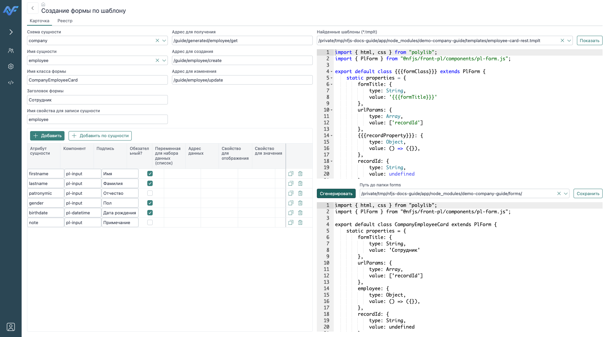

# Генератор форм

Открой в меню `@nfjs/dev` пункт «Генерация форм», затем форму «Создание формы по шаблону». Она берёт схему и таблицу PostgreSQL, предлагает метаданные полей, передаёт настройки в выбранный `.tmplt`, показывает получившийся JavaScript и сохраняет файл в `forms/<schema>/<entity>/`. Генератор создаёт клиентский файл формы; прикладные HTTP-маршруты и write-контракты он не генерирует.



## Этапы генерации

1. Вкладка «Карточка» или «Реестр»: выбери схему и таблицу. Список строится по обычным таблицам PostgreSQL (`relkind = 'r'`); представления и materialized views в этом выборе не отображаются.
2. Нажми «Добавить по сущности», чтобы загрузить атрибуты таблицы, или заполни поля вручную. Генератор использует имена и типы колонок, `NOT NULL`, комментарии и найденную ссылочную таблицу. Это исходные значения для формы, а не полный перенос схемы или бизнес-правил.
3. Укажи параметры формы и обработчиков, выбери `.tmplt` из списка активных NFJS-модулей либо отредактируй шаблон в поле редактора.
4. Нажми «Сгенерировать». Текст JavaScript появится в поле «Результат»; кнопка не сохраняет файл автоматически.
5. Выбери каталог `forms` и нажми «Сохранить». Файл записывается под фиксированным именем `card.js` или `list.js`.

Перед сохранением проверь весь результат: имена свойств, имя экспортируемого класса, привязки компонентов, адреса backend-операций и синтаксис JavaScript. Сохранение на существующий путь перезаписывает файл.

## Карточка

Настройки карточки находятся в `recordCard` и передаются генератору вместе с текстом шаблона.

| Поле | Назначение |
| --- | --- |
| `entitySchema` | Схема, метаданные которой используются для начального набора полей. |
| `entityName` | Таблица, метаданные которой используются для начального набора полей. |
| `formClass` | Имя экспортируемого класса формы; задай корректный идентификатор JavaScript. |
| `formTitle` | Заголовок формы. |
| `recordProperty` | Имя свойства формы с редактируемой записью; по умолчанию `record`. Шаблон использует его в объявлении свойства, биндингах и аргументах действий. |
| `inputs` | Массив настроек полей формы; свойства каждого элемента перечислены ниже. |
| `endpointRead` | Операция чтения одной записи. Сгенерированный шаблон передаёт обязательный `recordId`. |
| `endpointCreate` | Операция создания. В неё передаётся объект записи из `recordProperty`; ожидается ответ с `data.id`. |
| `endpointUpdate` | Операция изменения. В неё передаётся объект записи из `recordProperty`. |

Элементы `inputs` задают один компонент ввода каждый:

| Свойство | Назначение |
| --- | --- |
| `name` | Имя поля в объекте записи. |
| `component` | Имя компонента Polylib, например `pl-input` или `pl-combobox`. |
| `label` | Подпись компонента. |
| `required` | Включает атрибут обязательности компонента. |
| `dataName` | Имя свойства формы для данных выбора `pl-combobox`. |
| `dataEndpoint` | Источник данных для `pl-combobox`. |
| `dataTextProperty` | Свойство записи источника для отображаемого текста. |
| `dataValueProperty` | Свойство записи источника для выбранного значения. |

Кнопка «Добавить по сущности» использует метаданные колонок: `date`, `timestamp` и `timestamptz` предлагаются как `pl-datetime`, FK-колонки — как `pl-combobox`, остальные типы — как `pl-input`. Ссылочный столбец получает начальные значения `dataName` и `dataEndpoint` вида `*schema.table`; проверь, что источник данных действительно возвращает нужные для выбора поля. При нескольких внешних ключах на одной колонке запрос метаданных выбирает только одно совпадение.

`endpointRead` должен принимать `recordId` из `context.body.args` и возвращать запись в `data` как объект, поскольку `pl-action` привязывает его к свойству `recordProperty`. Пример краткой привязки в сгенерированной форме:

```html
<pl-action id="aRead"
  args="[[_compose('recordId', recordId)]]"
  data="{{record}}"
  endpoint="/api/entity/read"
  execute-on-args-change
  required-args="recordId"></pl-action>
```

При создании обработчик должен ответить `{ data: { id } }`; карточка присвоит этот идентификатор `recordId`. При редактировании форма выбирает `endpointUpdate`, когда в записи есть `id`.

## Реестр

Настройки списка находятся в `recordList`.

| Поле | Назначение |
| --- | --- |
| `entitySchema` | Схема, из которой берутся начальные метаданные колонок. |
| `entityName` | Таблица, из которой берутся начальные метаданные колонок. |
| `formClass` | Имя экспортируемого класса списка. |
| `formTitle` | Заголовок списка. |
| `columns` | Массив настроек `pl-table-column`; свойства каждого элемента перечислены ниже. |
| `filters` | Массив настроек `pl-filter-item`; свойства каждого элемента перечислены ниже. |
| `endpointList` | Endpoint, подключённый к `pl-dataset` списка. Он должен возвращать ответ в формате dataset и корректно обрабатывать control фильтрации/постраничной выборки, если backend использует эти возможности. |
| `endpointDelete` | Endpoint удаления; шаблон передаёт ему `{ id }` выбранной строки. |
| `cardForm` | Путь к одной форме карточки. Этот путь используется и для создания, и для редактирования; для редактирования шаблон дополнительно передаёт `recordId`. |

Элементы `columns` соответствуют колонкам `pl-table`:

| Свойство | Назначение |
| --- | --- |
| `field` | Поле строки данных. |
| `header` | Заголовок колонки. |
| `width` | Ширина колонки. |
| `resizable` | Разрешает менять ширину. |
| `sortable` | Включает сортировку колонки. |
| `sort` | Начальное направление сортировки. |
| `kind` | Вид отображения значения. |
| `format` | Форматирование значения. |

Элементы `filters` соответствуют фильтрам:

| Свойство | Назначение |
| --- | --- |
| `field` | Поле строки, к которому относится фильтр. |
| `component` | Компонент ввода значения фильтра. |
| `label` | Подпись компонента фильтра. |
| `operator` | Оператор фильтрации, если он нужен backend-контракту. |
| `cast` | Преобразование типа значения, если оно нужно backend-контракту. |

«Добавить по сущности» добавляет колонки с `field`, комментарием как `header`, `resizable: true` и `sortable: false`. Сортировку, форматирование, подписи и набор фильтров настрой отдельно. Генератор не выводит автоматически тип `kind`/`format`, операторы фильтров или SQL для `endpointList`.

Список использует `pl-table` и `pl-table-column`. После добавления, редактирования или удаления он повторно исполняет dataset. Адреса `endpointList`, `endpointDelete` и путь `cardForm` берутся из настроек; их backend-контракты должны существовать отдельно.

## Шаблоны, генерация и сохранение

Файлы `*.tmplt` ищутся через API расширений NFJS среди включённых модулей. `@nfjs/dev` применяет настройки к шаблону и возвращает текст JavaScript. Запись файла выполняется отдельной командой; синтаксис JavaScript и работоспособность маршрутов генератор не проверяет. Путь сохранения собирается так:

```text
<formPath>/<entitySchema>/<entityName>/card.js
<formPath>/<entitySchema>/<entityName>/list.js
```

`formPath` — выбранный каталог `forms` модуля; он должен быть тем модулем, где нужно хранить результат. Посмотри [справочник шаблонов](./templates), если нужно изменить структуру генерируемой формы или связать FSE-операции.

Проверь результат в приложении: открой список, выполни поиск, создай запись, открой её по `recordId`, измени и удали. Для combobox отдельно проверь, что dataset загружает нужный справочник.

<footer class="docs-sources">
  <span>Исходники:</span>
  <a href="https://github.com/nf-framework/nf-dev/blob/main/forms/dev/generate-form.js" target="_blank" rel="noopener">Форма генератора</a>
  <a href="https://github.com/nf-framework/nf-dev/blob/main/src/generateFormByTemplate/index.js" target="_blank" rel="noopener">Чтение метаданных, поиск шаблонов и сохранение</a>
  <a href="https://github.com/nf-framework/nf-dev/blob/main/src/generateFormByTemplate/form-card.js" target="_blank" rel="noopener">Настройки и генерация карточки</a>
  <a href="https://github.com/nf-framework/nf-dev/blob/main/src/generateFormByTemplate/form-list.js" target="_blank" rel="noopener">Настройки и генерация списка</a>
  <a href="https://github.com/nf-framework/nf-dev/blob/main/src/generateFormByTemplate/form-card.tmplt" target="_blank" rel="noopener">Базовый шаблон карточки</a>
  <a href="https://github.com/nf-framework/nf-dev/blob/main/src/generateFormByTemplate/form-list.tmplt" target="_blank" rel="noopener">Базовый шаблон списка</a>
  <a href="https://github.com/nf-framework/nf-dev/blob/main/nf-module.js" target="_blank" rel="noopener">Регистрация операций генератора</a>
</footer>
